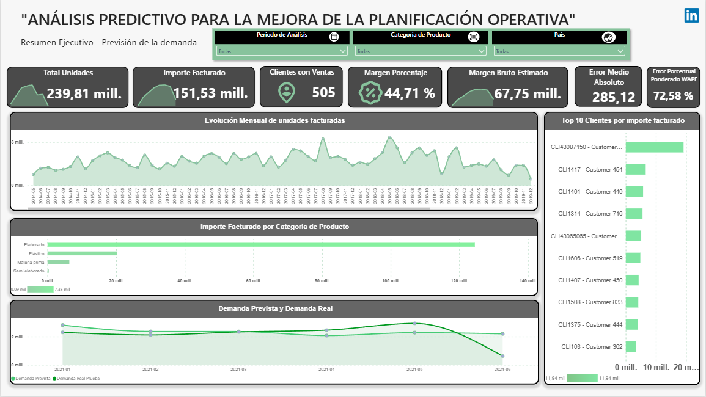

# IEBS Manufacturing: previsión de demanda y Business Intelligence

Solución integral de Business Intelligence y analítica predictiva para mejorar la planificación operativa de una empresa industrial. El proyecto transforma datos históricos de ventas de Microsoft Dynamics NAV en vistas analíticas de SQL Server, predicciones en Python y un cuadro de mando en Power BI.



## Objetivo

Estimar la demanda mensual por producto para apoyar decisiones de compras y producción, y proporcionar una visión integrada de facturación, unidades vendidas y margen bruto estimado.

## Arquitectura

```text
Dynamics NAV / SQL Server -> Vistas analíticas SQL -> Python (Random Forest) -> CSV de predicciones -> Power BI
```

## Resultados del modelo

El modelo se entrena con productos que tienen al menos 36 meses de histórico. Se reserva el periodo enero-junio de 2021 para prueba y se obtuvieron las siguientes métricas:

| Métrica | Resultado |
| --- | ---: |
| MAE | 285,14 unidades |
| WAPE | 72,58 % |

El resultado es una primera aproximación para apoyar la decisión, no un mecanismo de planificación automática.

## Estructura

- `sql/`: vistas de ventas, demanda mensual, selección de productos elegibles y consultas de validación.
- `src/`: entrenamiento y evaluación del modelo de previsión.
- `data/`: predicciones y métricas generadas por el modelo.
- `assets/`: captura del dashboard de resumen ejecutivo.
- `docs/`: memoria completa del proyecto.

## Ejecución

1. Restaura la fuente de datos en SQL Server y ejecuta las consultas de `sql/` en orden numérico.
2. Instala las dependencias:

   ```bash
   pip install -r requirements.txt
   ```

3. Comprueba la conexión a SQL Server en `src/modelo_prevision_demanda.py` y ejecuta:

   ```bash
   python src/modelo_prevision_demanda.py
   ```

El script consulta `dbo.vw_DemandaMensualModelo`, genera las predicciones y actualiza los archivos CSV de `data/`.

## Alcance y privacidad

No se incluyen la copia de seguridad de la base de datos, los conjuntos de datos fuente ni el archivo PBIX principal, ya que son demasiado grandes para el límite estándar de GitHub. El repositorio sí contiene los activos necesarios para comprender y reproducir la lógica de transformación y predicción.
